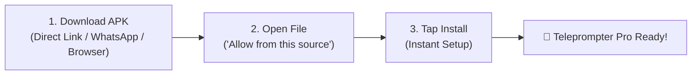
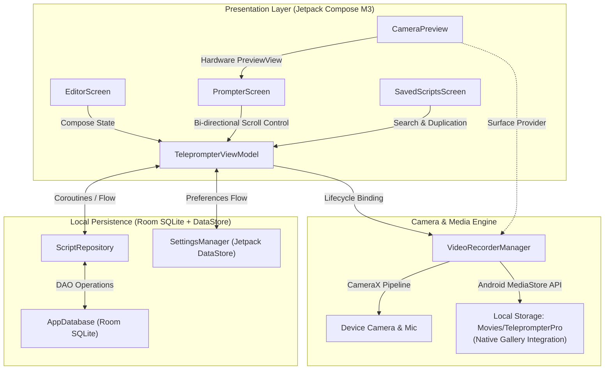

# 🎬 Teleprompter Pro

<p align="center">
  <strong>A professional, 100% offline studio teleprompter and video recording app for Android.</strong><br>
  Built with modern Jetpack Compose (Material 3), CameraX, and local SQLite Room database.<br>
  <em>Zero cloud. Zero tracking. Zero subscription. Zero data ever leaves your device.</em>
</p>

<p align="center">
  <a href="https://github.com/Md-Abdul-Kareem/teleprompter-pro/releases/latest"></a>
  <a href="https://github.com/Md-Abdul-Kareem/teleprompter-pro/actions/workflows/build-apk.yml"></a>
  
  
  
  
</p>

---

## ⚡ Direct Download (No Android Studio or SDK Needed!)

You **do not** need to download Android Studio, install the 8–10 GB Android SDK, or use Google Play Store to install Teleprompter Pro. 

### 📲 [📥 Click Here to Download Teleprompter-Pro.apk (v1.0.0)](https://github.com/Md-Abdul-Kareem/teleprompter-pro/releases/download/v1.0.0/Teleprompter-Pro.apk)

> **File Size:** ~20.5 MB  
> **Compatibility:** Android 7.0 (Nougat) up to Android 15 / 16  
> **Source:** Direct official build from GitHub Actions  

---

## 📱 Quick 30-Second Mobile Installation Guide



1. **Download:** Tap the [Download APK](https://github.com/Md-Abdul-Kareem/teleprompter-pro/releases/download/v1.0.0/Teleprompter-Pro.apk) link on your Android phone (or download it to your PC and send it to yourself via WhatsApp Web / Telegram / Google Drive).
2. **Open:** Tap on the downloaded `Teleprompter-Pro.apk` file in your notifications or Downloads folder.
3. **Allow Installation:**
   - If Android displays a prompt saying *"For your security, your phone is not allowed to install unknown apps from this source"*, tap **Settings**.
   - Toggle **"Allow from this source"** to **ON**.
4. **Install:** Tap **Install** &rarr; **Open**.
5. Grant Camera and Audio permissions when prompted for video recording, and you're ready to create!

> [!NOTE]
> ### 🛡️ Why does Android say "File might be harmful" or "Unrecognized app"?
> If your phone shows a security notice when downloading or installing, **this is standard Android behavior for all apps installed outside the Google Play Store**:
> - **Chrome warning ("File might be harmful"):** Tap **"Download anyway"**. Google Chrome displays this generic warning for *every* `.apk` file downloaded from the web.
> - **Play Protect ("Unrecognized app developer"):** Tap **"More details"** &rarr; **"Install anyway"**.
> - **100% Safe & Verified:** Teleprompter Pro is **completely open source** and requests **ZERO internet permissions** (`android.permission.INTERNET` is not even in the code). It is technically incapable of sending data, tracking you, or containing network malware.

---

## ✨ Key Features & Capabilities

| Feature | Description |
| :--- | :--- |
| 🛡️ **100% Private & Offline** | **Zero Internet permission.** No accounts, no servers, no ads, no telemetry, and no hidden AI calls. Your scripts and video recordings never leave your phone. |
| 📹 **Direct Gallery Recording** | Crisp 1080p/720p CameraX recording saved directly to your phone's standard local storage (`Movies/TeleprompterPro`). Videos appear immediately in your native **Gallery / Google Photos** app. |
| 🪞 **Beam-Splitter Mirror Mode** | Instant horizontal flip for physical glass teleprompter hoods. Inverts text display while keeping the camera recording background orientation natural. |
| ⚡ **Fluid 60/120 FPS Auto-Scroll** | Frame-synced auto-scroll with millisecond accuracy, adjustable speed (WPM / px/s), tactile touch-scrubbing override, and auto-pause on touch. |
| 👁️ **Eye-Level Contact Guide** | An adjustable cyan gradient guide-line keeping your eyes locked onto the front camera lens so your audience feels direct eye contact throughout the speech. |
| 🎨 **Calm Modern Studio UI** | Pure OLED dark background (`#0B0E14`), smooth spring-bounce button micro-interactions, customizable text margins, font sizes, line heights, and contrast colors. |
| 📝 **Built-in Script Studio** | Live word count, calibrated reading time estimator (based on customizable speaking speed), quick template starter, instant script duplication, search, and SQLite Room persistent storage. |
| ⏱️ **Countdown & Breathing Indicator** | 3-second animated countdown overlay prior to recording initiation, paired with a subtle breathing pulse indicator during active capture. |

---

## 🏗️ System Architecture & Data Flow

Teleprompter Pro is engineered for zero-latency studio recording, ensuring that scrolling, camera preview, and hardware encoding do not drop frames even during long sessions:



---

## 🔒 Complete Privacy & Permission Transparency

Teleprompter Pro respects user trust by eliminating network communication entirely:

```xml
<!-- From AndroidManifest.xml: ZERO INTERNET PERMISSION REQUESTED -->
<uses-permission android:name="android.permission.CAMERA" />
<uses-permission android:name="android.permission.RECORD_AUDIO" />
<uses-permission android:name="android.permission.WAKE_LOCK" />
<uses-permission android:name="android.permission.WRITE_EXTERNAL_STORAGE" android:maxSdkVersion="28" />
```

- **Camera & Microphone:** Exclusively used while actively recording in the Prompter studio.
- **Wake Lock:** Keeps your screen awake while reading long scripts so the display never sleeps mid-sentence.
- **Local Storage:** Saves finished videos directly to the public `Movies/TeleprompterPro` directory using Android's modern scoped `MediaStore` API.
- **Internet:** **NOT REQUESTED.** The application has no internet access capability and cannot communicate with any external server.

---

## 🛠️ How It Works (For Contributors & Developers)

### Automated Cloud Builds (GitHub Actions)

This repository includes a fully automated continuous integration pipeline at [`.github/workflows/build-apk.yml`](.github/workflows/build-apk.yml). 

Whenever new code is pushed to `main`, GitHub's cloud runners:
1. Provision a clean Ubuntu runner with JDK 21.
2. Accept Android SDK Platform 35 licenses.
3. Compile the debug APK using Gradle 9.3.1.
4. Export the resulting binary as an artifact and attach it to releases.

### Building Locally (Optional)

If you have Android Studio installed and wish to contribute code:

```bash
# Clone the repository
git clone https://github.com/Md-Abdul-Kareem/teleprompter-pro.git
cd teleprompter-pro

# Build the Debug APK
./gradlew assembleDebug

# Output APK location:
# app/build/outputs/apk/debug/app-debug.apk
```

---

## 📦 Tech Stack & Libraries

- **Language:** Kotlin 2.2.10
- **Build System:** Gradle 9.3.1 + Android Gradle Plugin (AGP) 9.1.1
- **UI Toolkit:** Jetpack Compose (BOM `2024.09.00`) with Material Design 3
- **Camera Engine:** AndroidX CameraX `1.5.0` (`camera-camera2`, `camera-lifecycle`, `camera-view`, `camera-video`)
- **Local Database:** AndroidX Room `2.7.0` (compiled via Google KSP `2.3.14`)
- **Preferences:** AndroidX DataStore Preferences `1.1.7`
- **Navigation:** AndroidX Navigation Compose `2.8.9`
- **Architecture:** MVVM + Clean Repository Pattern + Kotlin StateFlow

---

## 📄 License

```
Copyright 2026 Mohammed Abdul Kareem

Licensed under the Apache License, Version 2.0 (the "License");
you may not use this file except in compliance with the License.
You may obtain a copy of the License at

    http://www.apache.org/licenses/LICENSE-2.0

Unless required by applicable law or agreed to in writing, software
distributed under the License is distributed on an "AS IS" BASIS,
WITHOUT WARRANTIES OR CONDITIONS OF ANY KIND, either express or implied.
See the License for the specific language governing permissions and
limitations under the License.
```
